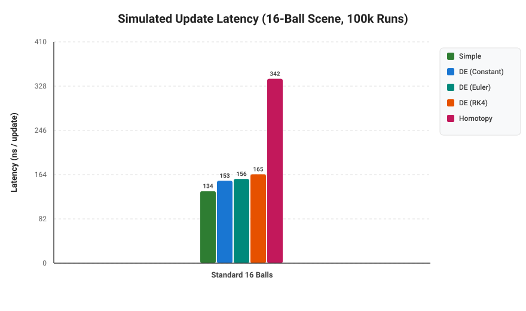
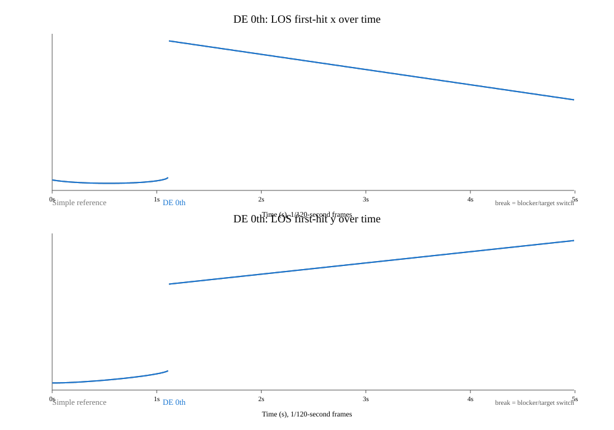
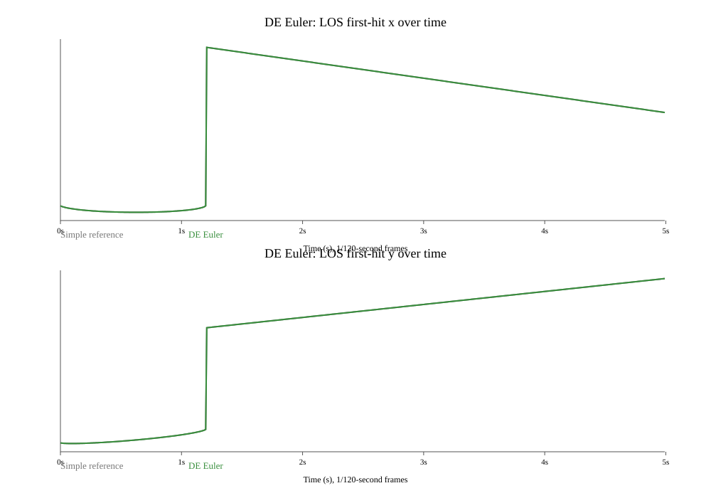
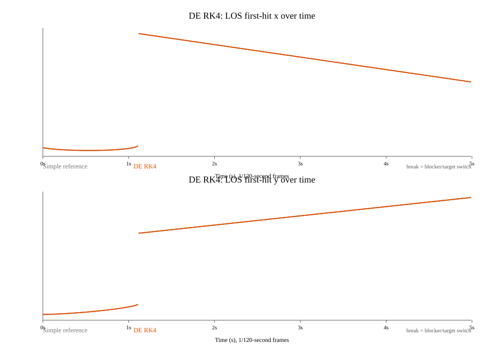
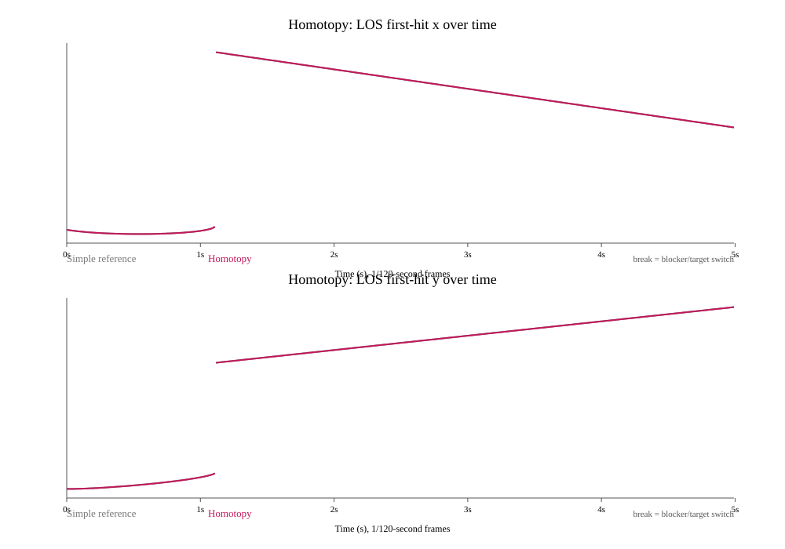

# Optimized Billiard
## The Idea
This project is an optimized implementation of a billiard-like scenario. Multiple "balls" (circles) move around a table and are tracked by a "cue" (a line).

Our goal is simple: given a position on a ball, make the cue track that position and draw a line from the cue to the first collision. The first collision may be with another ball blocking the tracked ball.

*We explore three different solutions:*

### **Simple**
We iterate over every ball at every frame and calculate the intersection between the cue and each ball. The line stops at the closest intersection.

This approach is straightforward, but its computational cost increases with the number of balls and frames.

### **Differential Equations**
We find the point to track in the first frame using the simple solution. We then build a nonlinear system of equations representing the ball and the cue line.

From this system, we construct a Jacobian matrix and use numerical integration together with Newton's Method to correct the error. This allows us to predict where the intersection point will move instead of recomputing it from scratch every frame.

### **Homotopy Continuation**
The previous approach may require solving a nonlinear system repeatedly. Although our particular problem is relatively simple (a line-circle intersection), we wanted to explore a more general technique that can also be applied to systems with many solutions.

With Homotopy Continuation, we start by solving a simpler version of the problem and continuously transform it into the actual system we want to solve.

Resources on Homotopy Continuation can be found [here](https://homotopycontinuation.github.io/). An implementation of the line-circle problem can also be found [here](https://github.com/rfabbri/minus).

## Context
This project was built by three students:
- [Bernardo Brust](https://github.com/bernardobrust)
- [Felipe Feliciano](https://github.com/FelipePF)
- [Gabriel Andrade](https://github.com/bielhxx)

It was developed for the elective course **"Special Topics in Programming Languages"**, which had three main goals:

- Learn a new programming language. We chose **Julia**, following our professor's recommendation.
- Solve an interesting computational geometry problem in the process.
- Learn new mathematical tools for solving real-world problems.

None of us had much experience with Julia before starting this project, so the code may not always follow Julia best practices. Please keep that in mind!

The original implementation was first sketched in Python. This repository contains the final implementation in Julia.

## Running
### Requirements
- The [Julia Language](https://julialang.org/)
- [SDL2](https://www.libsdl.org/) for [Julia](https://github.com/JuliaMultimedia/SimpleDirectMediaLayer.jl)

### Running
Julia uses a JIT compiler, so you can just call the compiler against main:
```bash
julia main.jl
```

On Wayland you may be required to switch to X11 and use `XWayland`:
```bash
SDL_VIDEODRIVER=x11 julia main.jl
```

To run with optimizations enabled:
```bash
julia -O3 -g0 main.jl
```

### Controls
- **Left Mouse Click**: Aim cue at clicked location or ball.
- **S Key**: Cycle through aiming calculation methods:
  - `Simple`: Closed-form geometric quadratic line-circle solver.
  - `Homotopy`: Polynomial homotopy path tracking.
  - `DE (Constant)`: Zero-order continuation with frame-to-frame temporal tracking and Newton displacement collision detection (bypasses differential equation integration).
  - `DE (Euler)`: First-order Euler prediction along the Davidenko differential equation followed by Newton correction.
  - `DE (RK4)`: 4th-order Runge-Kutta numerical integration of the Davidenko vector field followed by Newton correction.
- **Escape**: Exit application.

## Experiments and Results

Run `julia experiments/benchmark.jl` to regenerate the benchmark SVGs, or `julia experiments/tracked_point_trajectories.jl` to regenerate the tracking data and its separate solution plots. The benchmark advances a deterministic 16-ball scene, clears each DE solver's continuation history before each run, and performs the game's pre-physics and post-physics aim updates. It includes ball integration, wall reflections, and pair collisions; SDL rendering and event processing are excluded. Results are therefore simulated-update timings, not full-game FPS.

### Benchmark Results

The benchmark confirms that Simple is typically a very cheap baseline method for this small two-dimensional line-circle problem, as its ray checks use direct geometric calculations. The DE methods add predictor-corrector logic, while Homotopy tracks polynomial roots through a continuation path.

Across multiple benchmark runs, it can sometimes be the case that the DE methods are faster than the simple solution (particularly when temporal fast paths succeed and bypass checking other balls), but it is **never** the case that Homotopy is faster:

```text
-----------------------------------------------------------------
SIMULATED UPDATE LATENCY (aim + ball physics; rendering excluded):
-----------------------------------------------------------------
| Solution         | Update (ns) | Relative latency |
|:-----------------|------------:|-----------------:|
| Simple           |       257.6 |             1.00x |
| DE (Constant)    |       262.2 |             1.02x |
| DE (Euler)       |       232.8 |             0.90x |
| DE (RK4)         |       256.1 |             0.99x |
| Homotopy         |       538.4 |             2.09x |
-----------------------------------------------------------------
```

These figures vary by machine and runtime; the plots below show the full scaling and scenario measurements.




The methods solve the same geometric first-hit problem, so their tracked paths nearly overlap. In the 600-frame experiment, each DE and Homotopy path differs from the Simple reference by at most about 0.003 pixels. The experiment CSV records the hit type for every frame.

At about 1.12 seconds, the first-hit point jumps because the moving blocker leaves the cue ray. The closest intersection then changes from that blocker to the selected target ball. This geometric change occurs in Simple and all three DE variants as well as Homotopy; it is not a numerical blow-up. The plots break the lines at blocker-to-target switches so the transition does not look like a continuous trajectory.

#### Tracked first-hit point over time

Each plot shows one method against the Simple reference. The x and y coordinates are shown in separate panels; line breaks mark a change between hitting the blocker and hitting the target.









Simple is expected to do well here: it evaluates inexpensive closed-form line-circle intersections in only two dimensions. Higher-order predictors and continuation methods cannot remove the work of considering the candidate balls, and they add their own numerical work. In higher dimensions, with more complicated geometric constraints, or with polynomial systems that lack a cheap direct solution, methods such as predictor-corrector continuation or Homotopy can become more useful and may outperform a direct approach. That depends on the problem and should be measured rather than assumed.

### In-Game Performance vs. Benchmark Discrepancy (Why RK4 is ~600 FPS Faster In-Game)

When running the interactive game, switching to `DE (RK4)` often yields an immediate boost of **~600 FPS** over `DE (Constant)`, even though the offline benchmark shows Constant and RK4 having nearly identical simulated latency (with Constant appearing slightly faster).

This discrepancy stems from three interrelated mechanics: **temporal fast paths**, **numerical zeros in the Davidenko vector field**, and **benchmark dilution**.

#### 1. The Fast-Path Shortcut
In `DESolution.aim_cue!`, both methods attempt a temporal fast path before iterating over all $N$ balls. If the previously tracked blocker ball can be updated with high confidence, the solver accepts the result and **bypasses the remaining candidate ball loops entirely**:
```julia
# Newton corrector step
x_corr = newton_step(x_pred, p, n, c_now, rad)
newton_move_sq = (x_corr[1] - x_pred[1])^2 + (x_corr[2] - x_pred[2])^2
err = f_error(x_corr, p, n, c_now, rad)

if newton_move_sq < 0.25 && (err[1]*err[1] + err[2]*err[2]) < 1e-4 ...
    tracked_fast = true
end
```
When `tracked_fast` succeeds, no continuation paths are tracked, no linear systems are solved for other balls, and the raycast completes in virtually $0\text{ ns}$.

#### 2. Exact Numerical Zeros and RK4's High-Order Accuracy
RK4 integrates the Davidenko differential equation along the physical trajectory of the moving ball:
$$\frac{dx}{dt} = - J(x)^{-1} \frac{\partial f}{\partial t}$$
- **Ray Derivatives and Line-of-Sight Kinematics**:
  - When the aiming direction is fixed ($sid == 0$ or stationary cue), $dp/dt = (0, 0)$ and $dn/dt = (0, 0)$. In the partial derivative vector $\partial f / \partial t$, the line constraint error derivative is an exact numerical zero:
    $$\frac{\partial f_1}{\partial t} = \left(\frac{dn}{dt}\right)^T (x - p) - n^T \frac{dp}{dt} \equiv 0.0$$
    Because this component is identically zero, solving $J \frac{dx}{dt} = -\frac{\partial f}{\partial t}$ mathematically guarantees that $n^T \frac{dx}{dt} = 0$. The predicted velocity $dx/dt$ is **strictly collinear with the line-of-sight unit vector $u$**, reducing along the ray to:
    $$\frac{dx}{dt} = \left( \frac{(x - c)^T \dot{c}}{(x - c)^T u} \right) u$$
  - When dynamically aiming at a moving target ball ($sid \ne 0$), the line of sight rotates with angular velocity $\dot{n} = (\dot{u}_y, -\dot{u}_x)$, where $\dot{u} = \frac{v_{\text{target}} - (v_{\text{target}} \cdot u)u}{\|V\|}$, which the Davidenko vector field accounts for in $\partial f_1 / \partial t$.
- **$O(\Delta t^5)$ Local Precision**: Because the ball moves with constant velocity between bounces, RK4 tracks the constraint with fourth-order Runge-Kutta accuracy (local truncation error $O(\Delta t^5) \approx 10^{-11}$ at $\Delta t = 1/120\text{ s}$). The predicted point $x_{pred}$ lands so close to the true perimeter that the subsequent Newton correction displacement is practically negligible.
- As a result, `newton_move_sq < 0.25` and `err_sq < 1e-4` pass effortlessly on every frame, achieving nearly a **100% fast-path hit rate** in active gameplay.

#### 3. Why Constant (0-th Order) Frequently Drops Out of the Fast Path
Constant uses 0th-order position holding / linear finite-difference extrapolation from the previous frame (`x_pred = prev_sol + PREV_DELTA`). It bypasses Davidenko differential equations entirely. In real gameplay, it frequently fails the strict $0.25\text{ px}^2$ ($0.5\text{ px}$) fast-path threshold:
- **Zero-Order Step Lag on Blocker Appearance**: On the first frame a blocker appears, previous delta is uninitialized (`PREV_DELTA == 0.0`), predicting zero displacement (`x_pred = prev_sol`). At $140\text{ px/s}$, the ball moves $\sim 1.17\text{ px}$ in one frame, requiring a Newton shift of $1.17\text{ px}$ (`newton_move_sq` $\approx 1.37 > 0.25$), instantly failing the fast path.
- **Nonlinear Chord Acceleration**: As a circle moves across a ray, the intersection distance $t(t) = t_{proj}(t) - \sqrt{R^2 - d_\perp(t)^2}$ accelerates nonlinearly ($\ddot{t} \ne 0$). Constant linear extrapolation ignores this curvature ($\frac{1}{2}\ddot{x}\Delta t^2$), frequently exceeding the $0.25$ movement or $10^{-4}$ residual limit near entry and graze angles.
- **Fixed-Rate Accumulator Repeats**: In `Update.update_aim_at_fixed_rate!`, when frame drops cause multiple aim iterations per frame, physics does not advance between sub-steps. Constant blindly applies `PREV_DELTA` to stationary balls, requiring Newton to undo the offset, blowing up `newton_move_sq` and dropping out of the fast path.
- Whenever Constant misses the fast path, it falls back to the full $O(N)$ candidate loop and evaluates `track_continuation` on candidate roots.

#### 4. Why the Benchmark Hides This
1. **Physics Overhead Masks Solvers**: The benchmark measures `step!() = (advance_game_physics!(data); f!(data, sid))`. The $O(N^2)$ pairwise collision physics takes $\sim 180\text{ ns}$ out of the total $\sim 230\text{--}340\text{ ns}$, compressing the visible solver latency gap.
2. **Clear Line-of-Sight Dilution**: In the benchmark's 15,000 randomized frames, **78.4% of frames have unobstructed lines of sight**. When no blocker exists, `best_hit_id == 0` and neither solver takes the fast path; both perform identical quick bounding rejections.
3. **Continuation Asymmetry on Failure**: When the fast path *is* bypassed, Constant's `track_continuation` only performs a single Newton step, whereas RK4 performs 4 Runge-Kutta stages plus Newton correction. In synthetic tests without continuous tracking, Constant appears cheaper.
4. **Nonlinear FPS Scaling**: Frame rate scales inversely with time ($FPS = 1 / T_{frame}$). At ultra-high frame rates ($1500\text{--}2500\text{ FPS}$), a frame time delta of only $\sim 150\ \mu\text{s}$ produces a massive **~600 FPS gap** on the in-game display.

The benchmark renders SVG directly. If `rsvg-convert` is installed, it also creates PNG copies.

