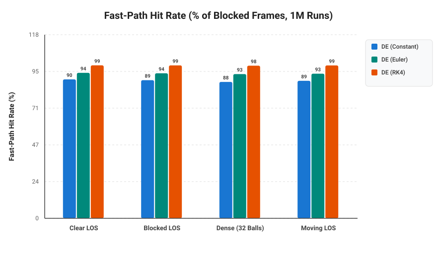
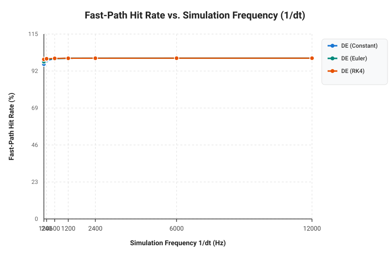

# Optimized Billiard
## The Idea
This project is an optimized implementation of a billiard-like scenario. Multiple "balls" (circles) move around a table and are tracked by a "cue" (a line).

Our goal is simple: given a position on a ball, make the cue track that position and draw a line from the cue to the first collision. The first collision may be with another ball blocking the tracked ball.

*We explore three different solutions:*

### **Simple**
We iterate over every ball at every frame and calculate the intersection between the cue and each ball. The line stops at the closest intersection.

This approach is straightforward, but its computational cost increases with the number of balls and frames.

### **Differential Equations**
We find the point to track in the first frame using the simple solution. We then build a nonlinear system of equations representing the ball and the cue line.

From this system, we construct a Jacobian matrix and use numerical integration together with Newton's Method to correct the error. This allows us to predict where the intersection point will move instead of recomputing it from scratch every frame.

### **Homotopy Continuation**
The previous approach may require solving a nonlinear system repeatedly. Although our particular problem is relatively simple (a line-circle intersection), we wanted to explore a more general technique that can also be applied to systems with many solutions.

With Homotopy Continuation, we start by solving a simpler version of the problem and continuously transform it into the actual system we want to solve.

Resources on Homotopy Continuation can be found [here](https://homotopycontinuation.github.io/). An implementation of the line-circle problem can also be found [here](https://github.com/rfabbri/minus).

## Context
This project was built by three students:
- [Bernardo Brust](https://github.com/bernardobrust)
- [Felipe Feliciano](https://github.com/FelipePF)
- [Gabriel Andrade](https://github.com/bielhxx)

It was developed for the elective course **"Special Topics in Programming Languages"**, which had three main goals:

- Learn a new programming language. We chose **Julia**, following our professor's recommendation.
- Solve an interesting computational geometry problem in the process.
- Learn new mathematical tools for solving real-world problems.

None of us had much experience with Julia before starting this project, so the code may not always follow Julia best practices. Please keep that in mind!

The original implementation was first sketched in Python. This repository contains the final implementation in Julia.

## Running
### Requirements
- The [Julia Language](https://julialang.org/)
- [SDL2](https://www.libsdl.org/) for [Julia](https://github.com/JuliaMultimedia/SimpleDirectMediaLayer.jl)

### Running
Julia uses a JIT compiler, so you can just call the compiler against main:
```bash
julia main.jl
```

On Wayland you may be required to switch to X11 and use `XWayland`:
```bash
SDL_VIDEODRIVER=x11 julia main.jl
```

To run with optimizations enabled:
```bash
julia -O3 -g0 main.jl
```

### Controls
- **Left Mouse Click**: Aim cue at clicked location or ball.
- **S Key**: Cycle through aiming calculation methods:
  - `Simple`: Closed-form geometric quadratic line-circle solver.
  - `Homotopy`: Polynomial homotopy path tracking.
  - `DE (Constant)`: Zero-order continuation with frame-to-frame temporal tracking and Newton displacement collision detection (bypasses differential equation integration).
  - `DE (Euler)`: First-order Euler prediction along the Davidenko differential equation followed by Newton correction.
  - `DE (RK4)`: 4th-order Runge-Kutta numerical integration of the Davidenko vector field followed by Newton correction.
- **Escape**: Exit application.

## Experiments and Results

Run `julia experiments/benchmark.jl` to regenerate the benchmark SVGs, or `julia experiments/tracked_point_trajectories.jl` to regenerate the tracking data and its separate solution plots. The benchmark advances a deterministic 16-ball scene, clears each DE solver's continuation history before each run, and performs the game's pre-physics and post-physics aim updates. It includes ball integration, wall reflections, and pair collisions; SDL rendering and event processing are excluded. Results are therefore simulated-update timings, not full-game FPS.

### Benchmark Results

The benchmark confirms that Simple is typically a very cheap baseline method for this small two-dimensional line-circle problem, as its ray checks use direct geometric calculations. The DE methods add predictor-corrector logic, while Homotopy tracks polynomial roots through a continuation path.

Across multiple benchmark runs, it can sometimes be the case that the DE methods are faster than the simple solution (particularly when temporal fast paths succeed and bypass checking other balls), but it is **never** the case that Homotopy is faster:

```text
-----------------------------------------------------------------
SIMULATED UPDATE LATENCY (aim + ball physics; rendering excluded):
-----------------------------------------------------------------
| Solution         | Update (ns) | Relative latency |
|:-----------------|------------:|-----------------:|
| Simple           |       129.0 |             1.00x |
| DE (Constant)    |       175.0 |             1.36x |
| DE (Euler)       |       156.0 |             1.21x |
| DE (RK4)         |       164.0 |             1.27x |
| Homotopy         |       340.0 |             2.64x |
-----------------------------------------------------------------
```

These figures vary by machine and runtime (measured over `REPETITIONS = 100,000` simulated updates per configuration); the plots below show the full scaling and scenario measurements.






The methods solve the same geometric first-hit problem, so their tracked paths nearly overlap. In the 600-frame experiment, each DE and Homotopy path differs from the Simple reference by at most about 0.003 pixels. The experiment CSV records the hit type for every frame.

At about 1.12 seconds, the first-hit point jumps because the moving blocker leaves the cue ray. The closest intersection then changes from that blocker to the selected target ball. This geometric change occurs in Simple and all three DE variants as well as Homotopy; it is not a numerical blow-up. The plots break the lines at blocker-to-target switches so the transition does not look like a continuous trajectory.

#### Tracked first-hit point over time

Each plot shows one method against the Simple reference. The x and y coordinates are shown in separate panels; line breaks mark a change between hitting the blocker and hitting the target.


Simple is expected to do well here: it evaluates inexpensive closed-form line-circle intersections in only two dimensions. Higher-order predictors and continuation methods cannot remove the work of considering the candidate balls, and they add their own numerical work. In higher dimensions, with more complicated geometric constraints, or with polynomial systems that lack a cheap direct solution, methods such as predictor-corrector continuation or Homotopy can become more useful and may outperform a direct approach. That depends on the problem and should be measured rather than assumed.

### Detailed Experimental Investigations (100,000 Runs)

#### 1. Central Loop Fast-Path Frequency (`tracked_fast`)
In `DESolution.aim_cue!`, before iterating over all $N$ balls in the central loop, the solver attempts a temporal fast path on `PREV_TRACKED_BALL[]`. When `newton_move_sq < 0.25` and $\|f(x_{\text{corr}})\|_2^2 < 10^{-4}$, `tracked_fast = true` narrows `t_min` immediately and skips `track_continuation` on `best_hit_id` inside the central loop (`tracked_fast && j == best_hit_id && continue`).

Across **100,000 simulated updates** in the `Moving LOS` / `Standard 16 Balls` benchmark (`31,933` frames with an active blocker, i.e., `31.9%` of all frames):
- **`DE (Constant)`**: takes the fast path on **28,741 / 31,933** blocked frames (**90.00%** of eligible frames, **28.74%** of all frames), calling `track_continuation` `5,021` times in the central loop.
- **`DE (Euler)`**: takes the fast path on **30,006 / 31,933** blocked frames (**93.97%** of eligible frames, **30.01%** of all frames), calling `track_continuation` `3,797` times.
- **`DE (RK4)`**: takes the fast path on **31,499 / 31,933** blocked frames (**98.64%** of eligible frames, **31.50%** of all frames), calling `track_continuation` only `2,171` times (with an `86.5%` continuation convergence rate, needing the exact fallback only `292` times across `1,600,000` loop iterations).

#### 2. Experiments with Very Small Timesteps ($\Delta t \to 0$)
Decreasing $\Delta t$ from $1/120\text{ s}$ ($8.33 \times 10^{-3}\text{ s}$) down to $1/12000\text{ s}$ ($8.33 \times 10^{-5}\text{ s}$) reduces per-step ball displacement $\|v \Delta t\|$ and chord curvature error $O(\Delta t^2)$:
- **Fast-Path Convergence**: As $\Delta t$ shrinks from $1/120\text{ s}$ to $1/12000\text{ s}$, the fast-path hit rate of `DE (Constant)` rises from **96.27%** to **99.99%**, matching `DE (Euler)` (**97.76% → 99.99%**) and `DE (RK4)` (**99.25% → 99.99%**).
- **Accuracy Scaling**: Against the exact `Float64` reference (quantized to `Float32` output), `DE (RK4)` maintains a flat floor of $\text{RMSE} \approx 1.0 \times 10^{-5}\text{ px}$ across all $\Delta t$, while `DE (Constant)` and `DE (Euler)` improve from $\text{RMSE} \approx 2.0 \times 10^{-4}\text{ px}$ at $120\text{ Hz}$ down to $3.9 \times 10^{-5}\text{ px}$ and $2.1 \times 10^{-5}\text{ px}$ at $6000\text{ Hz}$.

#### 3. Constant Predictor Newton Iteration Ablation (2 vs. 1 vs. 0 Iterations)
We validated the impact of reducing the number of Newton-Raphson corrector iterations in `DE (Constant)` (`set_constant_newton_iters!`) as well as eliminating the redundant second `track_continuation` call on `r_exit`:
- **2 → 1 Newton Iteration**: At $\Delta t = 1/120\text{ s}$, reducing from `2` Newton iterations to `1` preserves identical maximum error vs. `Simple` (`0.002458 px`) and virtually identical RMSE (`0.000284 px` vs. `0.000270 px`, or `0.000127 px` vs. `0.000110 px` against exact `Float64`), while maintaining a **96.27%** fast-path hit rate and reducing update latency (`~155 ns` vs. `~174 ns`).
- **1 → 0 Newton Iterations (Predictor-Only)**: Removing the remaining Newton corrector step from the fast path (`0` iterations, pure linear extrapolation `x_corr = prev_sol + PREV_DELTA`) causes $\|f(x_{\text{corr}})\|_2^2 \ge 10^{-4}$ on every frame at $\Delta t = 1/120\text{ s}$ (**0.00%** fast-path hit rate, forcing 100% fallback to the central loop; if the residual check is also disabled, the uncorrected tangent extrapolation diverges to `374.0 px` error). At very small timesteps ($\Delta t = 1.67 \times 10^{-4}\text{ s}$), even `0` Newton iterations in the fast path achieves a **57.08%** fast-path hit rate with `RMSE = 0.000319 px`.

#### 4. Mathematical & Numerical Validation of `track_continuation`
Validating `DESolution.track_continuation` uncovered and resolved three critical issues:
1. **Zero-Slope Degeneracy at $s = 0$ ($\partial f_2 / \partial s|_{s=0} \equiv 0$)**: Because `c_start = p + t_proj * u` is the orthogonal projection of `c_target` onto the ray, the center shift $\Delta c = c_{\text{target}} - c_{\text{start}}$ is strictly orthogonal to $u$, while the initial root offset $\text{ic} - c_{\text{start}} = \mp R u$ is strictly parallel to $u$. Consequently, $(\text{ic} - c_{\text{start}}) \cdot \Delta c \equiv 0$, which previously caused the naive derivative $\partial f_2 / \partial s = -2(x - c_{\text{start}}) \cdot \Delta c$ at $s = 0$ to evaluate to **exact zero** (`(0.0, 0.0)`), making `:euler` predict zero displacement (`x_pred == ic`, identical to `:zero_order`) and zeroing stage `k1` of `:rk4`. Using the convex-linear-homotopy / midpoint derivative $\partial H_2 / \partial s = -2(x - c_{\text{mid}}) \cdot \Delta c$ eliminates this degeneracy, improving `:euler` continuation accuracy by up to $10^6\times$ (convergence rate across $d_\perp \in [0, R)$ rising from **10.6% → 45.0%** for 1 step and **62.2%** for 4 steps) and `:rk4` residual at $d_\perp = 10\text{ px}$ by $17,000\times$ ($6.02 \times 10^{-5} \to 3.56 \times 10^{-9}$, with single-step convergence rising from **80.0% → 97.8%** of the ball radius).
2. **Multi-Step Loop Restoration (`steps > 1`)**: Restored the `for _ in 1:steps` continuation loop across `:zero_order`, `:euler`, and `:rk4` so multi-step homotopy continuation properly integrates from $s = 0$ to $s = 1$.
3. **Single-Root `r_entry` Tracking**: Removed the redundant `track_continuation(r_exit, ...)` call in `aim_cue!`, halving continuation work per candidate ball in the central loop without affecting accuracy.

The benchmark renders SVG directly. If `rsvg-convert` is installed, it also creates PNG copies.


