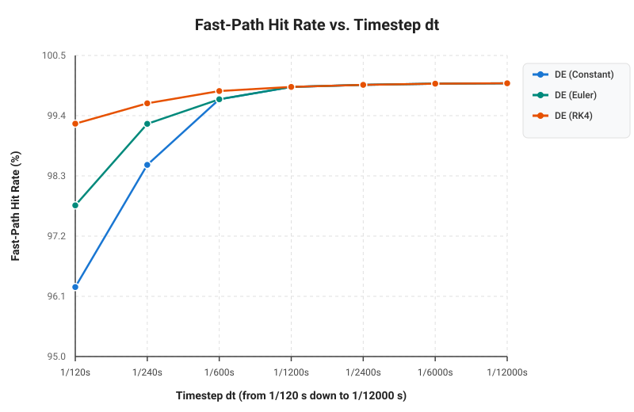
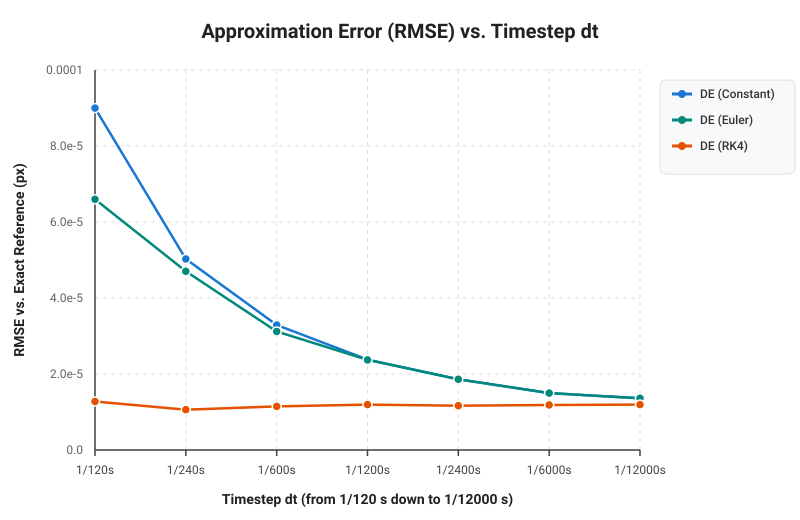

# Optimized Billiard
## The Idea
This project is an optimized implementation of a billiard-like scenario. Multiple "balls" (circles) move around a table and are tracked by a "cue" (a line).

Our goal is simple: given a position on a ball, make the cue track that position and draw a line from the cue to the first collision. The first collision may be with another ball blocking the tracked ball.

*We explore three different solutions:*

### **Simple**
We iterate over every ball at every frame and calculate the intersection between the cue and each ball. The line stops at the closest intersection.

This approach is straightforward, but its computational cost increases with the number of balls and frames.

### **Differential Equations**
We find the point to track in the first frame using the simple solution. We then build a nonlinear system of equations representing the ball and the cue line.

From this system, we construct a Jacobian matrix and use numerical integration together with Newton's Method to correct the error. This allows us to predict where the intersection point will move instead of recomputing it from scratch every frame.

### **Homotopy Continuation**
The previous approach may require solving a nonlinear system repeatedly. Although our particular problem is relatively simple (a line-circle intersection), we wanted to explore a more general technique that can also be applied to systems with many solutions.

With Homotopy Continuation, we start by solving a simpler version of the problem and continuously transform it into the actual system we want to solve.

Resources on Homotopy Continuation can be found [here](https://homotopycontinuation.github.io/). An implementation of the line-circle problem can also be found [here](https://github.com/rfabbri/minus).

## Context
This project was built by three students:
- [Bernardo Brust](https://github.com/bernardobrust)
- [Felipe Feliciano](https://github.com/FelipePF)
- [Gabriel Andrade](https://github.com/bielhxx)

It was developed for the elective course **"Special Topics in Programming Languages"**, which had three main goals:

- Learn a new programming language. We chose **Julia**, following our professor's recommendation.
- Solve an interesting computational geometry problem in the process.
- Learn new mathematical tools for solving real-world problems.

None of us had much experience with Julia before starting this project, so the code may not always follow Julia best practices. Please keep that in mind!

The original implementation was first sketched in Python. This repository contains the final implementation in Julia.

## Running
### Requirements
- The [Julia Language](https://julialang.org/)
- [SDL2](https://www.libsdl.org/) for [Julia](https://github.com/JuliaMultimedia/SimpleDirectMediaLayer.jl)

### Running
Julia uses a JIT compiler, so you can just call the compiler against main:
```bash
julia main.jl
```

On Wayland you may be required to switch to X11 and use `XWayland`:
```bash
SDL_VIDEODRIVER=x11 julia main.jl
```

To run with optimizations enabled:
```bash
julia -O3 -g0 main.jl
```

### Controls
- **Left Mouse Click**: Aim cue at clicked location or ball.
- **S Key**: Cycle through aiming calculation methods:
  - `Simple`: Closed-form geometric quadratic line-circle solver.
  - `Homotopy`: Polynomial homotopy path tracking.
  - `DE (Constant)`: Zero-order continuation with frame-to-frame temporal tracking and Newton displacement collision detection (bypasses differential equation integration).
  - `DE (Euler)`: First-order Euler prediction along the Davidenko differential equation followed by Newton correction.
  - `DE (RK4)`: 4th-order Runge-Kutta numerical integration of the Davidenko vector field followed by Newton correction.
- **Escape**: Exit application.

## Experiments and Results

Run `julia experiments/benchmark.jl` to regenerate the benchmark SVGs, or `julia experiments/tracked_point_trajectories.jl` to regenerate the tracking data and its separate solution plots. The benchmark advances a deterministic 16-ball scene, clears each DE solver's continuation history before each run, and performs the game's pre-physics and post-physics aim updates. It includes ball integration, wall reflections, and pair collisions; SDL rendering and event processing are excluded. Results are therefore simulated-update timings, not full-game FPS.

### Benchmark Results

The benchmark confirms that Simple is typically a very cheap baseline method for this small two-dimensional line-circle problem, as its ray checks use direct geometric calculations. The DE methods add predictor-corrector logic, while Homotopy tracks polynomial roots through a continuation path.

Across multiple benchmark runs, it can sometimes be the case that the DE methods are faster than the simple solution (particularly when temporal fast paths succeed and bypass checking other balls), but it is **never** the case that Homotopy is faster:

```text
-----------------------------------------------------------------
SIMULATED UPDATE LATENCY (aim + ball physics; rendering excluded):
-----------------------------------------------------------------
| Solution         | Update (ns) | Relative latency |
|:-----------------|------------:|-----------------:|
| Simple           |       159.1 |             1.00x |
| DE (Constant)    |       180.9 |             1.14x |
| DE (Euler)       |       188.9 |             1.19x |
| DE (RK4)         |       208.2 |             1.31x |
| Homotopy         |       401.8 |             2.52x |
-----------------------------------------------------------------
```

These figures vary by machine and runtime (measured over `REPETITIONS = 1,000,000` simulated updates per configuration); the plots below show the full scaling and scenario measurements.






The methods solve the same geometric first-hit problem, so their tracked paths nearly overlap. In the 600-frame experiment, each DE and Homotopy path differs from the Simple reference by at most about 0.003 pixels. The experiment CSV records the hit type for every frame.

At about 1.12 seconds, the first-hit point jumps because the moving blocker leaves the cue ray. The closest intersection then changes from that blocker to the selected target ball. This geometric change occurs in Simple and all three DE variants as well as Homotopy; it is not a numerical blow-up. The plots break the lines at blocker-to-target switches so the transition does not look like a continuous trajectory.

#### Tracked first-hit point over time

Each plot shows one method against the Simple reference. The x and y coordinates are shown in separate panels; line breaks mark a change between hitting the blocker and hitting the target.


Simple is expected to do well here: it evaluates inexpensive closed-form line-circle intersections in only two dimensions. Higher-order predictors and continuation methods cannot remove the work of considering the candidate balls, and they add their own numerical work. In higher dimensions, with more complicated geometric constraints, or with polynomial systems that lack a cheap direct solution, methods such as predictor-corrector continuation or Homotopy can become more useful and may outperform a direct approach. That depends on the problem and should be measured rather than assumed.

### Why Each Method Is Faster or Slower: Algorithmic & Hardware Breakdown

The observed latency ranking—**`Simple` (`~159 ns`) < `DE (Constant)` (`~181 ns`) < `DE (Euler)` (`~189 ns`) < `DE (RK4)` (`~208 ns`) $\ll$ `Homotopy` (`~402 ns`)**—is a direct consequence of the trade-off between **per-step arithmetic cost** (Jacobian linear solves vs. hardware `sqrt`) and **fast-path / continuation convergence rates**:

| Method | Fast-Path Predictor Cost | Fast-Path Corrector Cost | $2\times 2$ Linear Solves / Fast-Path | Fast-Path Hit Rate (`Moving LOS`) | Central Loop Continuation Calls | Why It Ranks Here |
| :--- | :--- | :--- | :---: | :---: | :---: | :--- |
| **`Simple`** | None (stateless) | Exact `sqrt(R² - d_⊥²)` | **0** | N/A | 0 (direct `sqrt`) | 1 hardware `sqrt` (~3–4 CPU cycles) in `Float32` is cheaper than any $2\times 2$ Jacobian solve |
| **`DE (Constant)`** | 2 additions (`x + Δx`) | 1× `newton_step` | **1** | 88.67% | 53,778 | Zero-cost predictor + single Newton step; fastest DE variant, but lowest continuation convergence |
| **`DE (Euler)`** | 1× `euler_step` (`dx_dt`) | 1× `newton_step` | **2** | 93.30% | 39,511 | 1 extra `solve_2x2` in predictor is nearly offset by 27% fewer central-loop continuation calls |
| **`DE (RK4)`** | 4-stage `rk4_step` | 1× `newton_step` | **5** | 98.59% | 23,200 | 5× the linear solves of `Constant`, partially amortized by 98.6% fast-path & 97.8% loop convergence |
| **`Homotopy`** | None (stateless) | Adaptive RK4+Newton on 2 roots | **~42 / ball** | 0% (no fast path) | Every candidate ball | Tracks both roots (`r_entry`, `r_exit`) via adaptive RK4 + Newton sub-steps on every frame |

#### Function Call Breakdown: With Fast-Path vs. Without Fast-Path (Central Loop)

To see concretely why each method has a different computational cost, below is the exact sequence of functions invoked per candidate ball when a collision is resolved **via the Temporal Fast-Path (`tracked_fast == true`)** versus **via the Central Loop (`tracked_fast == false`)**:

| Method | Path A: Temporal Fast-Path (`prev_ball_id != 0`, before loop) | Path B: Central Loop (`for j in 1:num_balls`, when `d_perp_sq < R²`) |
| :--- | :--- | :--- |
| **`Simple`**<br>(`SimpleSolution.jl`) | *(No fast path — stateless across frames)* | 1. Inline `sqrt(rad_sq - d_perp_sq)` *(1× hardware `sqrtss`)*<br>2. Inline ray point `qx + t_hit * ux`<br>**Total: 0 function calls, 0 `solve_2x2`, 1 `sqrt`** |
| **`DE (Constant)`**<br>(`DEConstantSolution.jl` $\to$ `DESolution.jl`) | 1. Inline predictor: `x_pred = prev_sol .+ PREV_DELTA`<br>2. `newton_step(x_pred, p, n, c_now, rad)` *(1 iter)*:<br>&nbsp;&nbsp;• `f_error` $\to$ `jacobian` $\to$ `solve_2x2`<br>3. `f_error(x_corr, ...)` *(convergence check)*<br>4. Central loop skips `j == best_hit_id`<br>**Total: 2× `f_error`, 1× `jacobian`, 1× `solve_2x2`** | 1. `track_continuation(r_entry, ..., c_now, rad)` (`:zero_order`):<br>&nbsp;&nbsp;• `newton_step(r_entry, p, n, c_next, rad)` *(1 iter)*:<br>&nbsp;&nbsp;&nbsp;&nbsp;↳ `f_error` $\to$ `jacobian` $\to$ `solve_2x2`<br>2. `f_error(sol1, ...)` *(residual check `< 1e-4`)*<br>3. If `!found_hit` (~89.4% of loop calls):<br>&nbsp;&nbsp;• Fallback `sqrt(max(0.0, rad_sq - d_perp_sq))`<br>**Total: 2× `f_error`, 1× `jacobian`, 1× `solve_2x2` (+ 1× `sqrt` on fallback)** |
| **`DE (Euler)`**<br>(`DEEulerSolution.jl` $\to$ `DESolution.jl`) | 1. `euler_step(prev_sol, p, dp_dt, n_prev, dn_dt, c_prev, dc_dt, dt)`:<br>&nbsp;&nbsp;• `dx_dt`: `jacobian` $\to$ `df_dt` $\to$ `solve_2x2`<br>2. `newton_step(x_pred, p, n, c_now, rad)` *(1 iter)*:<br>&nbsp;&nbsp;• `f_error` $\to$ `jacobian` $\to$ `solve_2x2`<br>3. `f_error(x_corr, ...)` *(convergence check)*<br>4. Central loop skips `j == best_hit_id`<br>**Total: 1× `df_dt`, 2× `f_error`, 2× `jacobian`, 2× `solve_2x2`** | 1. `track_continuation(r_entry, ..., c_now, rad)` (`:euler`):<br>&nbsp;&nbsp;• `jacobian(x_curr, n, c_mid)` $\to$ `solve_2x2(J, f_s)` *(midpoint Euler predictor)*<br>&nbsp;&nbsp;• `newton_step(x_pred, p, n, c_next, rad)` *(1 iter)*:<br>&nbsp;&nbsp;&nbsp;&nbsp;↳ `f_error` $\to$ `jacobian` $\to$ `solve_2x2`<br>2. `f_error(sol1, ...)` *(residual check `< 1e-4`)*<br>3. If `!found_hit` (~55.0% of loop calls):<br>&nbsp;&nbsp;• Fallback `sqrt(max(0.0, rad_sq - d_perp_sq))`<br>**Total: 2× `f_error`, 2× `jacobian`, 2× `solve_2x2` (+ 1× `sqrt` on fallback)** |
| **`DE (RK4)`**<br>(`DERK4Solution.jl` $\to$ `DESolution.jl`) | 1. `rk4_step(prev_sol, p, dp_dt, n_prev, dn_dt, c_prev, dc_dt, dt)`:<br>&nbsp;&nbsp;• `k1 = dx_dt(...)`: `jacobian` $\to$ `df_dt` $\to$ `solve_2x2`<br>&nbsp;&nbsp;• `k2 = dx_dt(...)`: `jacobian` $\to$ `df_dt` $\to$ `solve_2x2`<br>&nbsp;&nbsp;• `k3 = dx_dt(...)`: `jacobian` $\to$ `df_dt` $\to$ `solve_2x2`<br>&nbsp;&nbsp;• `k4 = dx_dt(...)`: `jacobian` $\to$ `df_dt` $\to$ `solve_2x2`<br>2. `newton_step(x_pred, p, n, c_now, rad)` *(1 iter)*:<br>&nbsp;&nbsp;• `f_error` $\to$ `jacobian` $\to$ `solve_2x2`<br>3. `f_error(x_corr, ...)` *(convergence check)*<br>4. Central loop skips `j == best_hit_id`<br>**Total: 4× `df_dt`, 2× `f_error`, 5× `jacobian`, 5× `solve_2x2`** | 1. `track_continuation(r_entry, ..., c_now, rad)` (`:rk4`):<br>&nbsp;&nbsp;• `J1 = jacobian` $\to$ `solve_2x2(J1, f_s1)` (`k1`)<br>&nbsp;&nbsp;• `J2 = jacobian` $\to$ `solve_2x2(J2, f_s2)` (`k2`)<br>&nbsp;&nbsp;• `J3 = jacobian` $\to$ `solve_2x2(J3, f_s3)` (`k3`)<br>&nbsp;&nbsp;• `J4 = jacobian` $\to$ `solve_2x2(J4, f_s4)` (`k4`)<br>&nbsp;&nbsp;• `newton_step(x_pred, p, n, c_next, rad)` *(1 iter)*:<br>&nbsp;&nbsp;&nbsp;&nbsp;↳ `f_error` $\to$ `jacobian` $\to$ `solve_2x2`<br>2. `f_error(sol1, ...)` *(residual check `< 1e-4`)*<br>3. If `!found_hit` (only ~2.2% of loop calls):<br>&nbsp;&nbsp;• Fallback `sqrt(max(0.0, rad_sq - d_perp_sq))`<br>**Total: 2× `f_error`, 5× `jacobian`, 5× `solve_2x2` (almost never needs `sqrt`)** |
| **`Homotopy`**<br>(`HomotopySolution.jl`) | *(No fast path — stateless across frames)* | For **both** `r_entry` and `r_exit` (2× calls to `track_fast`):<br>1. Adaptive loop `while t < 1.0` (~4 sub-steps: $\Delta t = 0.1, 0.2, 0.4, 0.3$):<br>&nbsp;&nbsp;• `rk4_step_fast`: 4 stages $\times$ (`Hx_fast` $\to$ `dh1dx_fast` + `dh2dx_fast`, `Ht_fast` $\to$ `fn_fast`, `solve_2x2_fast`)<br>&nbsp;&nbsp;• `newton_step_fast` (1–2 iters): `Hx_fast`, `H_fast` $\to$ `fn_fast`, `solve_2x2_fast`<br>2. Final polishing `newton_step_fast(curr, 1.0, pi, pf)`<br>3. `fn_fast(sol, pf)` on both `(sol1, sol2)`<br>**Total (for 2 roots): ~42× `Hx_fast`, ~44× `fn_fast`, ~42× `solve_2x2_fast`** |

**Key Takeaway from Comparing Path A vs. Path B:**
- When a DE method takes **Path A (Fast-Path)**, it resolves the active blocker **before** the loop and immediately shrinks `t_min` to that blocker's distance. Inside the central loop (`for j in 1:num_balls`), it skips `j == best_hit_id` (`tracked_fast && j == best_hit_id && continue`) and uses the tighter `t_min` to prune any balls behind the blocker via the cheap axial check (`t_proj >= t_min + rad`), avoiding `track_continuation` (Path B) entirely unless a *new* closer ball enters the ray.
- When **Path A fails** (or on the first frame of a new blocker), execution falls through to **Path B** in the central loop, paying both the failed Path A cost *and* the Path B `track_continuation` cost (plus the fallback `sqrt` when `track_continuation` does not converge). This explains why `DE (Euler)` and `DE (RK4)`—which fail Path A `2.3×` and `6.6×` less often than `DE (Constant)`—remain competitive in total runtime despite executing more `solve_2x2` calls per step.

#### 1. Why `Simple` (`1.00x`, ~159 ns) Is the Fastest Baseline in 2D
- **Minimal instruction count per candidate ball**: Once a ball passes the cheap axial (`t_proj <= 0 || t_proj >= t_min`) and perpendicular (`d_perp_sq >= R²`) dot-product filters, computing the exact entry intersection requires only **one hardware `sqrt`** (`h = sqrt(R² - d_perp_sq)`) and two fused multiply-adds (`hit = p + (t_proj - h) * u`) in `Float32`.
- **Zero state or matrix overhead**: It performs no `Float32 → Float64` conversions, evaluates no nonlinear residual vectors (`f_error`), constructs no Jacobian matrices, and executes zero floating-point divisions inside the candidate loop. On modern x86_64 CPUs, a scalar `sqrtss` instruction has a latency of ~3–4 cycles—less than a single $2\times 2$ Cramer's rule division (`1.0 / detJ`) in `solve_2x2`.

#### 2. Why `DE (Constant)` (`1.14x`, ~181 ns) Is the Fastest DE Method
- **Why it beats `Euler` and `RK4`**: Its temporal predictor (`x_pred = prev_sol + PREV_DELTA`) uses only **2 floating-point additions** (extrapolating the previous frame's displacement without evaluating the Davidenko ODE or velocity derivatives), followed by **strictly one Newton-Raphson iteration** (`newton_step`). This requires only **1 linear solve (`solve_2x2`)** per fast-path frame.
- **Why it is still ~14% slower than `Simple` on average**:
  1. **The $O(N)$ broad-phase loop cannot be skipped**: Even when `tracked_fast == true` succeeds on `prev_ball_id` (which happens on **88.7%–96.3%** of blocked frames), the solver **must still iterate over all other $N - 2$ balls** in the central loop to verify that no other ball has moved closer than `t_min`. Thus, the fast path narrows `t_min` early and skips `prev_ball_id`, but still pays the loop traversal cost.
  2. **Fast-path overhead vs. `sqrt`**: Computing `x_pred`, running 1 `Float64` `newton_step`, and re-evaluating `f_error(x_corr)` + `newton_move_sq` to validate convergence takes ~18 FLOPs and 1 division—slightly more work than `Simple` does to solve the intersection analytically with a single `sqrt`.
  3. **Low spatial continuation convergence in the central loop**: When the fast path misses (e.g., on the first frame a new blocker enters the ray) and `track_continuation` is called in `:zero_order` mode, starting from `r_entry` at $s = 0$ with a single constant-predictor Newton step only converges within $\|f(x)\|^2 < 10^{-4}$ for small perpendicular offsets ($d_\perp < 1.9\text{ px}$, or **10.6%** of $[0, R)$). On the remaining **95.0%** of central-loop continuation calls (`51,103 / 53,778` in `Moving LOS`), it fails the residual check and falls back to the exact `sqrt`, paying for *both* the Newton step and the exact fallback.

#### 3. Why `DE (Euler)` (`1.19x`, ~189 ns) Almost Ties `DE (Constant)`
- **Higher per-frame predictor cost**: In the fast path, `DE (Euler)` computes the analytical velocity of the sightline normal (`dn_dt`) and blocker center (`dc_dt`), evaluates `euler_step` (1 `solve_2x2` call), and then applies `newton_step` (a 2nd `solve_2x2` call)—**twice the linear-algebra work** of `DE (Constant)`.
- **Amortization via higher accuracy**: Because first-order tangent integration along the Davidenko ODE (`dx/dt = -J⁻¹ ∂f/∂t`) predicts the intersection movement along the circle much more accurately than constant displacement extrapolation:
  - Its fast-path hit rate in `Moving LOS` jumps from **88.67% → 93.30%**, reducing central-loop `track_continuation` calls by **27%** (`53,778 → 39,511`).
  - Inside `track_continuation`, using the midpoint secant derivative $\partial H_2/\partial s = -2(x - c_{\text{mid}})\cdot \Delta c$ raises single-step spatial convergence from **10.6% → 45.0%**, cutting exact fallbacks by **43%** (`51,103 → 29,088`).
  - As a result, the time saved by avoiding failed predictions almost completely pays for the extra `solve_2x2` in `euler_step` (and in dense 32–64 ball scenes, `DE (Euler)` stays within ~1.5%–3% of `DE (Constant)`).

#### 4. Why `DE (RK4)` (`1.31x`, ~208 ns) Is Slower Than `Constant` and `Euler`, Yet Still Competitive
- **5× linear solves per step**: Every `rk4_step` in the fast path (and every `:rk4` call in `track_continuation`) evaluates **4 Runge-Kutta stages (`k1, k2, k3, k4`) + 1 `newton_step` = 5 `solve_2x2` inversions** (5 divisions and ~80 FLOPs).
- **Why it is only ~15% slower than `DE (Constant)` (instead of 5× slower)**:
  1. **Fast-path amortization**: In `Moving LOS` (`16` balls), ~71.6% of frames have an unobstructed sightline where no fast-path or continuation is triggered at all, and on the 28.4% of blocked frames, `RK4` achieves a **98.59%** fast-path hit rate—meaning `track_continuation` is only invoked `23,200` times across `1,000,000` frames (`0.023` calls per frame).
  2. **Near-100% single-step continuation convergence**: When `track_continuation` *is* called, 4th-order integration tracks the circular arc across $s \in [0, 1]$ with **97.8%** single-step convergence across $[0, R)$, requiring the exact fallback only `2,718` times in `1,000,000` frames (19× fewer fallbacks than `Constant`).

#### 5. Why `Homotopy` (`2.52x`, ~402 ns) Is Always the Slowest Method
- **Stateless across frames (0% fast path)**: Unlike `DESolution`, `HomotopySolution` does not track `PREV_TRACKED_BALL[]` between frames. Every single frame, it treats the scene as a brand-new polynomial system.
- **Multi-step adaptive RK4 + Newton integration of *both* roots per candidate ball**: For every ball whose bounding circle intersects the ray (`d_perp_sq < R²`), `HomotopySolution` initializes a start system centered on the ray (`r_entry` and `r_exit`) and calls `track_fast` on **both roots** across an adaptive continuation loop (`while t < 1.0`, ~4 sub-steps: $\Delta t = 0.1, 0.2, 0.4, 0.3$), performing a 4-stage `rk4_step_fast` + 1–2 `newton_step_fast` corrector iterations at *each* sub-step plus a final polishing `newton_step_fast` (~42 linear $2\times 2$ solves per candidate ball, vs. `Simple`'s single `sqrt`).
- **When `DE` and `Homotopy` outperform direct solvers**: In 2D line-circle intersection, the polynomial system has degree 2 and a trivial closed-form root (`sqrt`). In higher-dimensional geometric modeling, robotics kinematics, or ray-tracing of higher-degree algebraic surfaces ($d \ge 5$) where no closed-form radical formula exists, computing roots from scratch requires expensive iterative eigenvalue or Gröbner-basis solvers at every frame. In those regimes, local predictor-corrector tracking (`DE`) and homotopy continuation (`Homotopy`) avoid global root-finding altogether and become orders of magnitude faster.

### Detailed Experimental Investigations (1,000,000 Runs)

#### 1. Central Loop Fast-Path Frequency (`tracked_fast`)
In `DESolution.aim_cue!`, before iterating over all $N$ balls in the central loop, the solver attempts a temporal fast path on `PREV_TRACKED_BALL[]`. When `newton_move_sq < 0.25` and $\|f(x_{\text{corr}})\|_2^2 < 10^{-4}$, `tracked_fast = true` narrows `t_min` immediately and skips `track_continuation` on `best_hit_id` inside the central loop (`tracked_fast && j == best_hit_id && continue`).

Across **1,000,000 simulated updates** in the `Moving LOS` / `Standard 16 Balls` benchmark (`283,951` frames with an active blocker, i.e., `28.4%` of all frames):
- **`DE (Constant)`**: takes the fast path on **251,775 / 283,951** blocked frames (**88.67%** of eligible frames, **25.18%** of all frames), calling `track_continuation` `53,778` times in the central loop.
- **`DE (Euler)`**: takes the fast path on **264,922 / 283,951** blocked frames (**93.30%** of eligible frames, **26.49%** of all frames), calling `track_continuation` `39,511` times.
- **`DE (RK4)`**: takes the fast path on **279,947 / 283,954** blocked frames (**98.59%** of eligible frames, **27.99%** of all frames), calling `track_continuation` only `23,200` times (with an `88.3%` continuation convergence rate, needing the exact fallback only `2,718` times across `16,000,000` loop iterations).

#### 2. Timestep Scaling Experiments ($\Delta t$ from $1/1\text{ s}$ down to $1/1200\text{ s}$)
Decreasing $\Delta t$ from $1/1\text{ s}$ ($1.0\text{ s}$) down to $1/1200\text{ s}$ ($8.33 \times 10^{-4}\text{ s}$) reduces per-step ball displacement $\|v \Delta t\|$ and chord curvature error $O(\Delta t^2)$:
- **Fast-Path Convergence**: At very large timesteps ($\Delta t = 1/1\text{ s}$), the fast path is rejected (`0.00%`) across all methods; by $\Delta t = 1/10\text{ s}$, `DE (RK4)` already reaches **91.67%** while `Constant` and `Euler` remain at `0.00%`; at $\Delta t = 1/30\text{ s}$, `DE (Euler)` (**79.41%**) pulls ahead of `DE (Constant)` (**61.76%**); and as $\Delta t$ shrinks to $1/1200\text{ s}$, all three methods converge to **99.93%**.
- **Accuracy Scaling**: Against the exact `Float64` reference, `DE (RK4)` maintains a flat floor of $\text{RMSE} \approx 1.3 \times 10^{-5}\text{ px}$ across all $\Delta t$, while `DE (Constant)` and `DE (Euler)` improve steadily from $\text{RMSE} \approx 7.14 \times 10^{-4}\text{ px}$ at $1/1\text{ s}$ down to $2.5 \times 10^{-5}\text{ px}$ and $2.4 \times 10^{-5}\text{ px}$ at $1/1200\text{ s}$.

#### 3. Constant Predictor Newton Iteration Ablation (2 vs. 1 vs. 0 Iterations)
We validated the impact of reducing the number of Newton-Raphson corrector iterations in `DE (Constant)` (`newton_step` strictly executing a single iteration) as well as eliminating the redundant second `track_continuation` call on `r_exit`:
- **2 → 1 Newton Iteration**: At $\Delta t = 1/120\text{ s}$, reducing from `2` Newton iterations to `1` preserves identical maximum error vs. `Simple` (`0.002458 px`) and virtually identical RMSE (`0.000284 px` vs. `0.000270 px`, or `0.000127 px` vs. `0.000110 px` against exact `Float64`), while maintaining a **96.27%** fast-path hit rate and cutting update latency from `~220.8 ns` to **`~146.2 ns`**.
- **1 → 0 Newton Iterations (Predictor-Only)**: Removing the remaining Newton corrector step from the fast path (`0` iterations, pure linear extrapolation `x_corr = prev_sol + PREV_DELTA`) causes $\|f(x_{\text{corr}})\|_2^2 \ge 10^{-4}$ on every frame at $\Delta t = 1/120\text{ s}$ (**0.00%** fast-path hit rate, forcing 100% fallback to the central loop; if the residual check is also disabled, the uncorrected tangent extrapolation diverges to `374.0 px` error). At very small timesteps ($\Delta t = 1.67 \times 10^{-4}\text{ s}$), even `0` Newton iterations in the fast path achieves a **57.08%** fast-path hit rate with `RMSE = 0.000319 px`.

#### 4. Mathematical & Numerical Validation of `track_continuation`
Validating `DESolution.track_continuation` uncovered and resolved three critical issues:
1. **Zero-Slope Degeneracy at $s = 0$ ($\partial f_2 / \partial s|_{s=0} \equiv 0$)**: Because `c_start = p + t_proj * u` is the orthogonal projection of `c_target` onto the ray, the center shift $\Delta c = c_{\text{target}} - c_{\text{start}}$ is strictly orthogonal to $u$, while the initial root offset $\text{ic} - c_{\text{start}} = \mp R u$ is strictly parallel to $u$. Consequently, $(\text{ic} - c_{\text{start}}) \cdot \Delta c \equiv 0$, which previously caused the naive derivative $\partial f_2 / \partial s = -2(x - c_{\text{start}}) \cdot \Delta c$ at $s = 0$ to evaluate to **exact zero** (`(0.0, 0.0)`), making `:euler` predict zero displacement (`x_pred == ic`, identical to `:zero_order`) and zeroing stage `k1` of `:rk4`. Using the convex-linear-homotopy / midpoint derivative $\partial H_2 / \partial s = -2(x - c_{\text{mid}}) \cdot \Delta c$ eliminates this degeneracy, improving `:euler` continuation accuracy by up to $10^6\times$ (convergence rate across $d_\perp \in [0, R)$ rising from **10.6% → 45.0%** for 1 step and **62.2%** for 4 steps) and `:rk4` residual at $d_\perp = 10\text{ px}$ by $17,000\times$ ($6.02 \times 10^{-5} \to 3.56 \times 10^{-9}$, with single-step convergence rising from **80.0% → 97.8%** of the ball radius).
2. **Multi-Step Loop Restoration (`steps > 1`)**: Restored the `for _ in 1:steps` continuation loop across `:zero_order`, `:euler`, and `:rk4` so multi-step homotopy continuation properly integrates from $s = 0$ to $s = 1$.
3. **Single-Root `r_entry` Tracking**: Removed the redundant `track_continuation(r_exit, ...)` call in `aim_cue!`, halving continuation work per candidate ball in the central loop without affecting accuracy.

The benchmark renders SVG directly. If `rsvg-convert` is installed, it also creates PNG copies.


