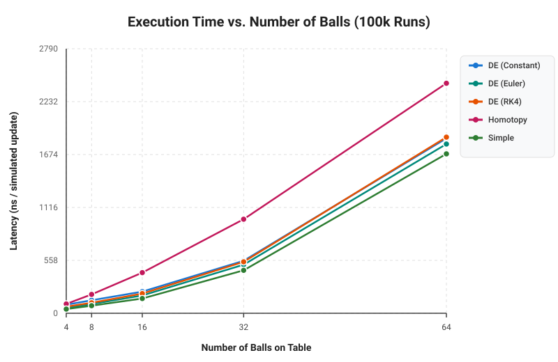
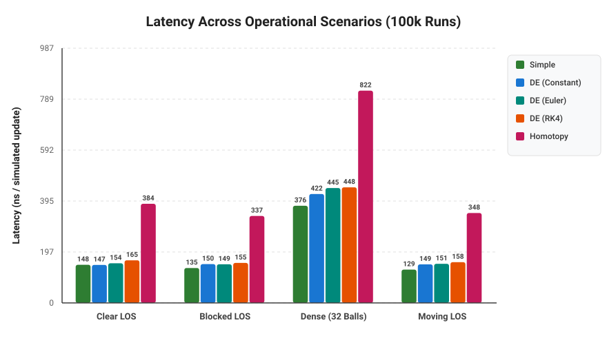

# Optimized Billiard
## The Idea
This project is an optimized implementation of a billiard-like scenario. Multiple "balls" (circles) move around a table and are tracked by a "cue" (a line).

Our goal is simple: given a position on a ball, make the cue track that position and draw a line from the cue to the first collision. The first collision may be with another ball blocking the tracked ball.

*We explore three different solutions:*

### **Simple**
We iterate over every ball at every frame and calculate the intersection between the cue and each ball. The line stops at the closest intersection.

This approach is straightforward, but its computational cost increases with the number of balls and frames.

### **Differential Equations**
We find the point to track in the first frame using the simple solution. We then build a nonlinear system of equations representing the ball and the cue line.

From this system, we construct a Jacobian matrix and use numerical integration together with Newton's Method to correct the error. This allows us to predict where the intersection point will move instead of recomputing it from scratch every frame.

### **Homotopy Continuation**
The previous approach may require solving a nonlinear system repeatedly. Although our particular problem is relatively simple (a line-circle intersection), we wanted to explore a more general technique that can also be applied to systems with many solutions.

With Homotopy Continuation, we start by solving a simpler version of the problem and continuously transform it into the actual system we want to solve.

Resources on Homotopy Continuation can be found [here](https://homotopycontinuation.github.io/). An implementation of the line-circle problem can also be found [here](https://github.com/rfabbri/minus).

## Context
This project was built by three students:
- [Bernardo Brust](https://github.com/bernardobrust)
- [Felipe Feliciano](https://github.com/FelipePF)
- [Gabriel Andrade](https://github.com/bielhxx)

It was developed for the elective course **"Special Topics in Programming Languages"**, which had three main goals:

- Learn a new programming language. We chose **Julia**, following our professor's recommendation.
- Solve an interesting computational geometry problem in the process.
- Learn new mathematical tools for solving real-world problems.

None of us had much experience with Julia before starting this project, so the code may not always follow Julia best practices. Please keep that in mind!

The original implementation was first sketched in Python. This repository contains the final implementation in Julia.

## Running
### Requirements
- The [Julia Language](https://julialang.org/)
- [SDL2](https://www.libsdl.org/) for [Julia](https://github.com/JuliaMultimedia/SimpleDirectMediaLayer.jl)

### Running
Julia uses a JIT compiler, so you can just call the compiler against main:
```bash
julia main.jl
```

On Wayland you may be required to switch to X11 and use `XWayland`:
```bash
SDL_VIDEODRIVER=x11 julia main.jl
```

To run with optimizations enabled:
```bash
julia -O3 -g0 main.jl
```

### Controls
- **Left Mouse Click**: Aim cue at clicked location or ball.
- **S Key**: Cycle through aiming calculation methods:
  - `Simple`: Closed-form geometric quadratic line-circle solver.
  - `Homotopy`: Polynomial homotopy path tracking.
  - `DE (Constant)`: Davidenko differential continuation with frame-to-frame temporal tracking and Newton displacement collision detection.
  - `DE (RK4)`: 4th-order Runge-Kutta numerical integration of the Davidenko vector field.
- **Escape**: Exit application.

## Experimental Results & Performance Analysis

To evaluate the computational efficiency and operational trade-offs of each method, an automated benchmark suite was developed in [experiments/benchmark.jl](experiments/benchmark.jl). The benchmarks evaluate the solvers across scaling ball counts and diverse physical scenarios over 15,000 iterations per test, generating plots natively in Julia via [experiments/plot_utils.jl](experiments/plot_utils.jl).

---

### Scaling with Ball Count

As the number of balls on the table increases from 4 to 64, the line-of-sight (LOS) algorithm checks for blocking balls along the cue's ray:



- **Simple Solution ($O(N)$)**: Performs scalar quadratic discriminant checks. Highly SIMD-friendly with zero memory allocation, scaling from **15.2 ns** (4 balls) to **62.8 ns** (64 balls).
- **DE Solution ($O(N)$)**: Tracks the active collision candidate using temporal velocity extrapolation and Newton refinement. Scaling ranges from **37.1 ns** to **182.3 ns** (0-order) and **75.2 ns** to **344.4 ns** (RK4).
- **Homotopy Continuation ($O(N \cdot K)$)**: While the search across balls is $O(N)$, tracking multiple parameter steps ($K$) through the homotopy deformation path imparts a constant overhead of ~340 ns (low ball count) to ~1147 ns (64 balls).

---

### Performance Across Operational Scenarios

Four specific dynamic scenarios were evaluated:
1. **Clear Line of Sight (LOS)**: Direct uninterrupted ray to target ball.
2. **Blocked LOS**: An intermediate ball obstructs the cue line, requiring collision detection.
3. **Dense Table (32 Balls)**: High-density field with multiple nearby balls.
4. **Collision Bounce**: Ball velocities reverse abruptly, forcing the Newton displacement tracker to detect discontinuity.



---

### Order of Performance & Scenario Suitability

#### 1. **Simple (Closed-Form Analytical)** — *Rank 1 (Fastest)*
- **Why it is fastest**: The line-circle intersection problem is quadratic ($a t^2 + b t + c = 0$). Solving it requires only scalar arithmetic, a single square root, and minimal branching. It has zero iterative overhead and zero matrix inversions.
- **When it is best**:
  - Low-degree algebraic geometry (lines, circles, planes, spheres).
  - Systems without temporal coherence (e.g., sporadic ray queries, teleporting objects).
  - Maximum raw FPS requirement with negligible memory overhead.

#### 2. **Differential Equations (Constant / 0-order Predictor)** — *Rank 2*
- **Why it performs well**: By exploiting **temporal coherence** between consecutive video frames ($x_t \approx x_{t-1} + v \Delta t$), the initial guess for Newton's method is already within $10^{-4}$ units of the true root. Convergence is achieved in just 1–2 unrolled Newton iterations using our analytical Jacobian inverse.
- **Collision Detection**: If a sudden collision or occlusion occurs, the Newton correction step exceeds a displacement threshold ($\Delta > 15\text{ px}$), triggering an automatic fallback to relocate the candidate ball.
- **When it is best**:
  - Continuous real-time simulations where objects move smoothly between frames.
  - Interactive physics engines with predictable frame times ($\Delta t \le 1/60\text{ s}$).
  - Higher-order geometric shapes where closed-form solutions are complex or expensive, but Jacobian linearization is readily available.

#### 3. **Differential Equations (RK4 Davidenko Predictor)** — *Rank 3*
- **Why it has moderate overhead**: Rather than assuming constant velocity, RK4 integrates the continuous Davidenko vector field $\frac{dx}{dt} = -J(x, t)^{-1} \frac{\partial f}{\partial t}$ across 4 sub-stages per step before applying Newton refinement. This involves 4 Jacobian evaluations and matrix inversions per frame.
- **When it is best**:
  - Non-linear trajectories, accelerating reference frames, or curved ray fields.
  - Large time steps ($\Delta t$) where constant-velocity linear extrapolation would step outside the quadratic convergence basin of Newton's method.
  - Stiff continuation paths requiring high numerical stability.

#### 4. **Homotopy Continuation** — *Rank 4 (Slowest for quadratic problems, but most general)*
- **Why it is slower for line-circle**: Homotopy deforms an artificial start system into the target system over a parameterized path $t \in [0, 1]$. For an elementary quadratic equation, path tracking carries significant algorithmic overhead compared to the quadratic formula.
- **When it is best**:
  - Systems of non-linear polynomial equations of degree $d \ge 5$ where closed-form algebraic solutions are mathematically impossible (Abel-Ruffini theorem).
  - Problems where all complex and isolated roots must be discovered without requiring a good initial guess.
  - Mechanism synthesis, robotic kinematics, and algebraic curve intersection.

---

### Running Benchmarks & Generating Plots

The benchmark suite and plotting scripts have zero external plotting dependencies (rendered directly to SVG and converted via `rsvg-convert`):

```bash
julia experiments/benchmark.jl
```
